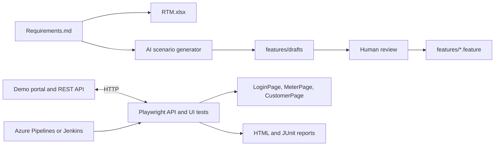
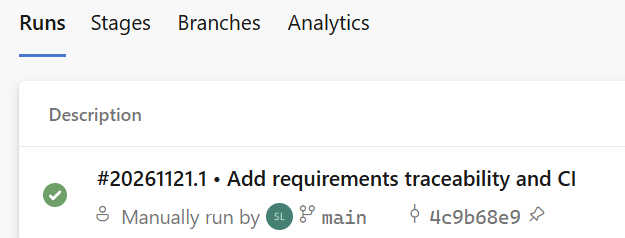
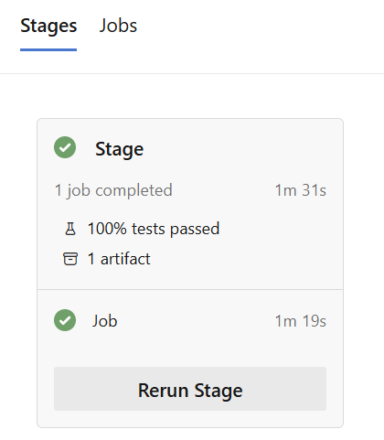
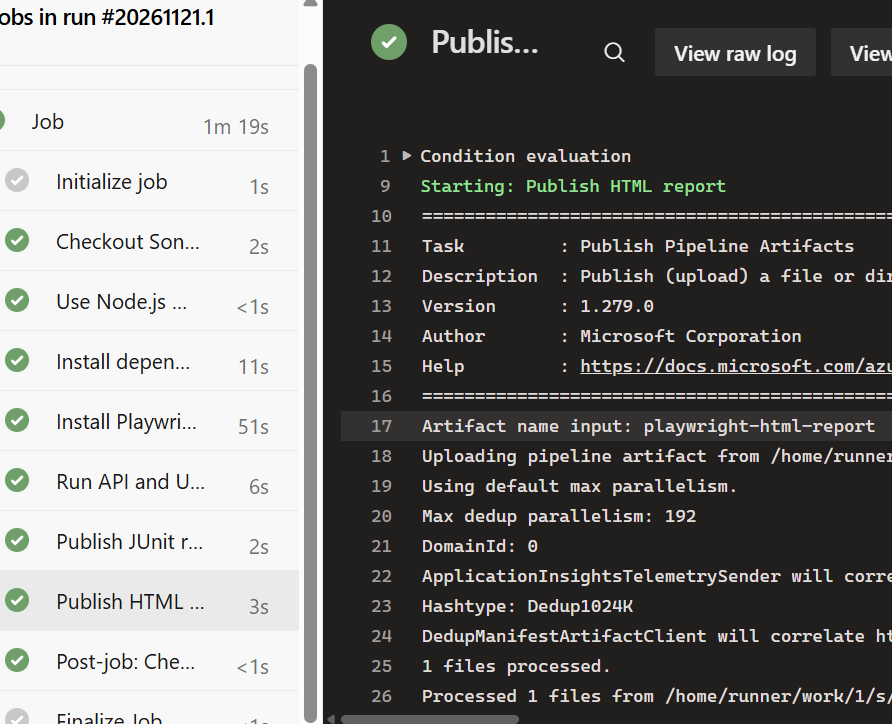

# Utilities Project

Playwright and BDD starter project for UI and API test automation.

## Architecture



## Setup

Install dependencies and the Playwright browser:

```powershell
npm install
npx playwright install
Copy-Item .env.example .env
```

Playwright starts the demo app automatically for tests. To run it separately, use `npm run start:demo`; it is served at `http://127.0.0.1:4173`. Demo login: `meteradmin` / `Meter123`. API and UI share in-memory sample data.

## Requirements and traceability

- [Requirements](./Requirements.md) lists the ten testable behaviors.
- [Test strategy](./TestStrategy.md) describes scope, execution, and acceptance criteria.
- [RTM.xlsx](./RTM.xlsx) maps each requirement to its automated test.

## Commands

- `npx playwright test --project=api` runs the meter API tests.
- `npx playwright test --project=ui --headed` opens the demo portal and runs the UI test.
- `npm run test:ui` generates and runs both page-object UI tests and BDD tests.
- `npm test` generates BDD tests and runs the full suite.
- `npm run start:demo` runs the demo app outside Playwright.
- `npm run generate:rtm` regenerates [RTM.xlsx](./RTM.xlsx) from [Requirements.md](./Requirements.md).
- `npm run generate:scenarios` drafts a Gherkin file from [Requirements.md](./Requirements.md).

## AI-generated scenarios

Copy `.env.example` to `.env` and set `AI_API_URL`, `AI_API_KEY`, and `AI_MODEL` for an OpenAI-compatible chat-completions endpoint. The generator sends the requirements to that configured endpoint and writes a draft to `features/drafts/requirements.feature`. **A human must review and edit AI output before moving any accepted feature into `features/` or treating it as test coverage.** Keep API keys in `.env`; do not commit them. `BASE_URL` and `API_URL` optionally override the local UI and API addresses.

## CI

`azure-pipelines.yml` runs the suite on pushes to `main`, publishes JUnit test results, and uploads the HTML report as the `playwright-html-report` pipeline artifact. `Jenkinsfile` runs the same suite in the official Playwright Docker image and publishes JUnit/HTML reports.

The Azure pipeline is configured from `azure-pipelines.yml` and publishes JUnit results and the HTML report artifact on each run.

### Passing Azure run

Azure DevOps run `#20261121.1` for commit `4c9b68e` succeeded. The stage reported 100% tests passed and published the HTML report artifact.







## Test reports

- HTML: `reports/html`
- JUnit: `reports/junit.xml`
